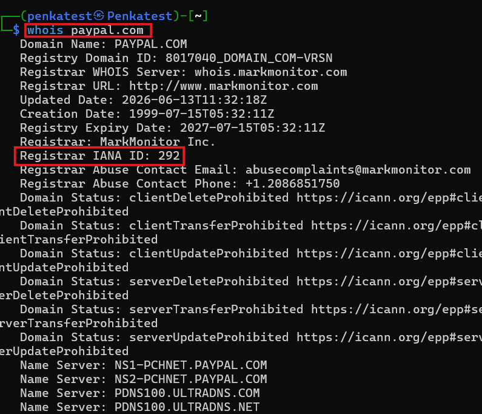
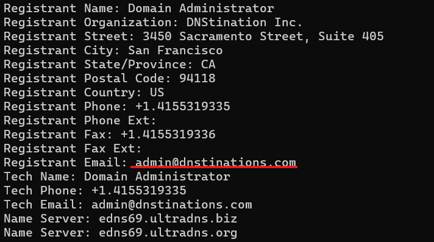

# Giới thiệu
`Information Gathering` là giai đoạn đầu tiên và quan trong trong quy trình kiểm thử xâm nhập. Các mục tiêu chính trong việc thu nhập thông tin web bao gồm:
- `Identifying Assets`: Khám phá tất cả các thành phần có thể thể truy cập công khai của target như là web pages, subdomain, IP address,..
- `Discovering Hidden Information`: Định vị các thông tin nhạy cảm mà target vô tình để lộ bao gồm: file sao lưu, file cấu hình hoặc các tài liệu nội bộ
- `Analysing the attack surface`: Kiểm tra bề mặt tất công của target để nhận dạng các lỗ hổng và điểm yếu tiềm năng
- `Gathering Intelligence`: Thu nhập thông tin có thể được tận dụng cho khai thác thêm hoặc cuộc tấn công `social engineering`. Gồm email address, phone,..

# Các loại Reconnaissance
# Active Reconnaissance
Attacker sẽ chủ động tương tác trực tiếp với hệ thống mục tiêu để thu nhập thông tin như:
- `Port scanning`: nhận dạng các port và service đang chạy trên target
- `Vulnerability Scanning`: Thăm dò các lỗ hổng đã biết như là cấu hình sai hoặc phần mềm vũ. Công cụ sử dụng như Nessus, Nikto,..
- `Networking mapping`: Lập bản đồ cấu trúc mạng của mục tiêu bao gồm các thiết bị được kết nối và mối quan hệ giữa chúng . Công cụ nmap, traceroute
- `Banner Grabbing`: Lấy thông tin như banner của service đang chạy trên target. Công cụ netcat, curl
- `OS Fingerprinting`: Nhận dạng hệ điều hành trên target
- `Service enumeration`: Xác định các phiên bản cụ thể của service đang chạy trên các cổng mở
- `Web Spidering`: Thu thâp dữ liệu từ trang web mục tiêu để xác định các trang web, thư mục và tệp tin
# Passive Renconnaissance
Ngược lại, Passive Renconnaissance sẽ thu thập thông tin mà không cần tương tác với target. Các kĩ thuật bao gồm:
- `Search Engine Queries`: Sử dụng các công cụ search engine như google, bing, shodan để tìm kiếm thông tin về target như website, trang mạng xã hội cá nhân,..
- `WHOIS lookups`: Truy vấn cơ sở dữ liệu WHOIS để lấy chi tiết thông tin đăng kí domain
- `DNS`: Phân tích các bản ghi để nhận dạng subdomain, mail server,..
- `Web Archive Analysis`: Kiểm tra lịch sử snapshot của website mục tiêu. Công cụ như: Wayback Machine
- `Social Media Anaylysis`: Thu thâp thông tin từ các nền tảng mạng xã hội như facebook, x,...
- `Code Repositories`: Các kho lưu trữ code trên github của target

# Section 3: Utilising WHOIS
>***Perform a WHOIS lookup against the paypal.com domain. What is the registrar Internet Assigned Numbers Authority (IANA) ID number?***

>***What is the admin email contact for the tesla.com domain (also in-scope for the Tesla bug bounty program)?***

Truy vấn bằng lệnh `whois telsa.com` nhìn mục Registrant Email trong phần admin

