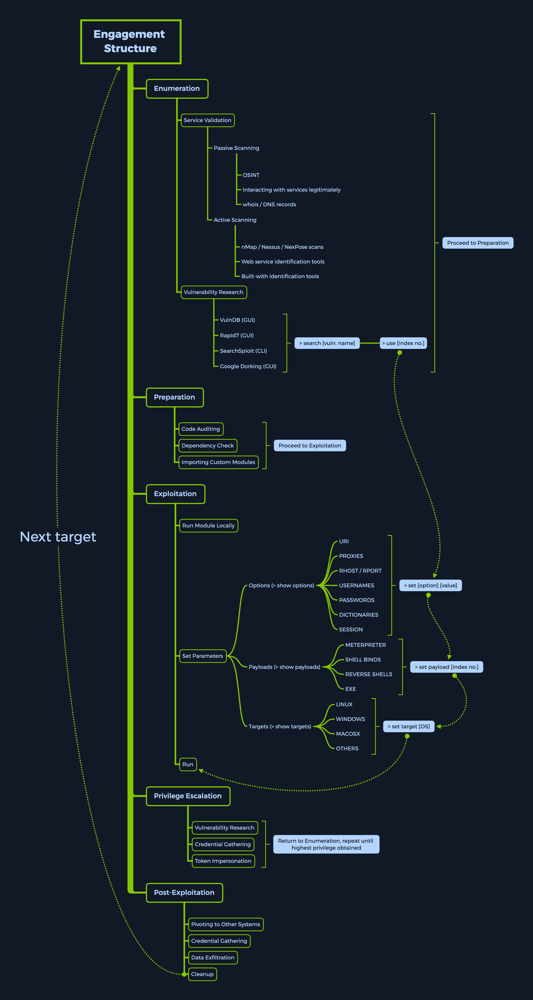

# Introduction
Metasploit project là 1 nền tảng kiểm thử xâm nhập dạng module, được viết bằng ngôn ngữ ruby. Nó cho phép bạn viết, kiểm thử và thực thi các mã khai thác lỗ hổng. Mã khai thác có thể lấy từ database hoặc do người dùng tự viết.

Metasploit Framework bao gồm một bộ công cụ mà bạn có thể sử dụng để kiểm tra các lỗ hổng bảo mật, liệt kê thông tin về mạng, thực hiện các cuộc tấn công và né tránh sự phát hiện. Về cốt lõi, Metasploit project là một tập hợp các công cụ được sử dụng phổ biến, cung cấp môi trường hoàn chỉnh cho việc kiểm thử xâm nhập và phát triển mã khai thác lỗ hổng.

Module được hiểu là những mã khai thác thử nghiệm chứng minh tính khả thi thực tế, đã được phát triển và kiểm thử trong môi trường thực tế, sau đó được tích hợp framework. Điểm mạnh của nó là cung cấp rất nhiều mục tiêu và phiên bản có sẵn, chỉ bằng vài lệnh là có thể có được foothold trong hệ thống mục tiêu. Nếu với hợp với các mã khai thác thì nó cho phép chúng ta thực sự truy cập vào hệ thống.

Metasploit được chia thành 2 version là Metasploit Pro và Metasploit Framework. Phần này sẽ tập trung vào Metasploit Framework.

# Metasploit Framework Console
msfconsole là interface phổ biến của Metasploit Framework. Nó cung cấp một console tập trung theo mô hình "ALL in one" và cho phép bạn truy cập hiệu quả vào hầu hết như tất cả các tùy chọn có sẵn trong MSF

# Understanding the Architecture
1. Data, Documentation, Lib : chứa dữ liệu, thư viện chức năng và tài liệu kỹ thuật của Framework
2. Modules: Chứa các module được chia thành nhiều loại như auxiliary,exploits, payloads,...
3. Plugin: Mở rộng chức năng cho msfconsole
4. Scripts: Chứa các tập lệnh hỗ trợ Metapreter và những chức năng khác.
5. Tools: Chứa các tiện ích lòng lệnh phục vụ nhiều tác vụ khác nhau
# MSF Engagement Structure
MSF Engagement Structure được chia ra thành 5 loại chính:
- Enumeration
- Preparation
- Exploitaion
- Privilege Escalation
- Post-Exploitation
Với mỗi loại chúng sẽ có những thành phần con khác nhau.

## Type of Module
| Type | Description |
| --- | --- |
| `Auxiliary` | Scanning, fuzzing, sniffing và chức năng quản trị |
| `Encoder` | Đảm bảo payload được giữ nguyên vẹn trong quá trình chuyển đến mục tiêu |
| `Exploits` | Các module khai thác lỗ hổng bảo mật, cho phép phân phối payload |
| `NOPs` | Mã không thực hiện thao tác để giữ kích thước payload nhất quán giữa các lần thử khai thác |
| `Payloads` | Mã được thực thi từ xa và thiết lập kết nối tới máy của kẻ tấn công |
| `Post` | Cung cấp nhiều module để thu thập thông tin, pivot sâu hơn vào trong hệ thống và thực hiện các tác vụ hậu khai thác |
