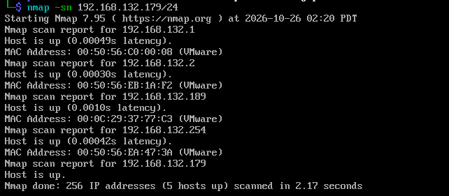
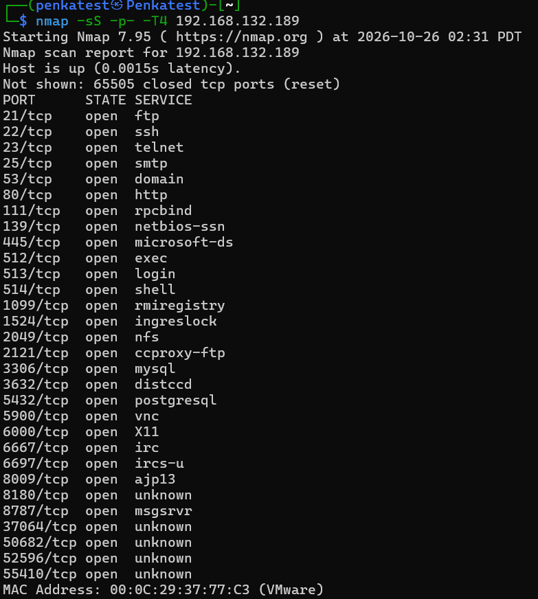
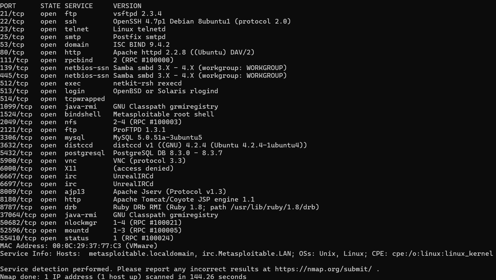
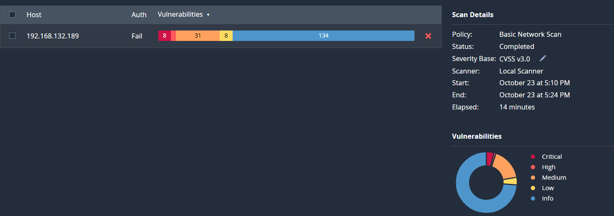

# THU THẬP THÔNG TIN
### Xác định địa chỉ IP của target
Sử dụng nmap ta có thể tìm được IP của máy metasploitable 2:
```
nmap -sn <địa chỉ ip cùng mạng>
```



Lưu ý: Các host `.1`, `.2` `.254` là của vmware và `.179` không hiển thị địa chỉ MAC là máy của mình. `.189` sẽ địa chỉ IP của máy metasploitable 2.
### Thực hiện quét port và service bằng nmap

```
nmap -sS -p- -T4 192.168.132.189
```
Kết quả trả về có biết các 30 port và service đang được mở 


Mình sẽ sử dụng nmap để xem version của service cụ thể trên. Lý do mình không xác thực version ở đầu vì muốn tối ưu time khi quét

```
nmap -sV --version-all -p 21,22,23,25,53,80,111,139,445,512,513,514,1099,1524,2049,2121,3306,3632,5432,5900,6000,6667,6697,8009,8180,8787,37064,50682,52596,55410 192.168.132.189
```
Như có thể thấy kết quả trả về các version của service có trên hệ thống. Search mình thấy các version trên đều khá cũ, vì vậy chúng sẽ có thể tồn tại các lỗ hổng. Để phát hiện cụ thể là lỗ hổng nào mình sẽ sử dụng nessus để tiến hành quét.



### Quét lỗ hổng bằng công cụ nesussed

Kết quả thu được gồm 70 lỗ hổng trong đó:

|Số lượng|Mức độ|
|--|--|
|8|Critical|
|2|High|
|31|Medium
|8|Low|
|134|Info|

# Khai thác các lỗ hổng 

